# gpt-ui-assets

A [Claude Code](https://claude.com/claude-code) skill that designs **platform-native** screens for phones, tablets,
foldables, desktop apps and the web with GPT image models, and turns an approved design into **production assets and
a 1:1 build**. It runs on an OpenAI-compatible API key or on the **local Codex CLI** with your ChatGPT plan.

Every icon, illustration and background is **redrawn from scratch at full resolution and matched 1:1**; nothing is
cropped out of the screenshot. You also get:
- SVG / Android VectorDrawable icons;
- launcher icons for Android, iOS and the web;
- frame animations, Lottie and AnimatedVectorDrawable;
- theme code and fonts measured from the pixels;
- a screenshot diff that tells you exactly what your built screen gets wrong.

Claude is the driver. GPT is one instrument, and each job goes to whatever does it best:
- **GPT image:** mockups, painterly art, raster frames.
- **GPT vision:** inventory, critique, SVG icons, vector keyframes.
- **Local measurement:** scoring, colour matching, tracing, rigging, font matching, redlines, diffs.
- **Claude:** reviews every result and writes the code.

<p align="center">
  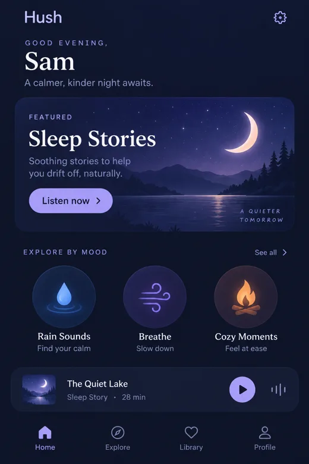
  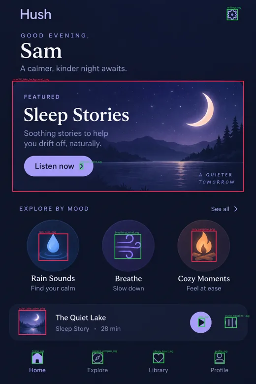
  
</p>

## Why

When you ask GPT for "the assets of this design", it usually **crops them out of the mockup**. You get
low-resolution pixels with the card background baked in, neighbouring text bleeding in, and cut-off edges. Asking it to
redraw them from a text prompt gives **generic art in a different style**.

This skill does what a designer would do instead:
1. It inventories the assets.
2. It redraws each one from scratch, with a **focused crop of the element as the only reference**.
3. It scores candidates against the design with a perceptual metric.
4. It colour-corrects the winner in CIELAB.
5. It rejects copies and crops automatically.

<p align="center">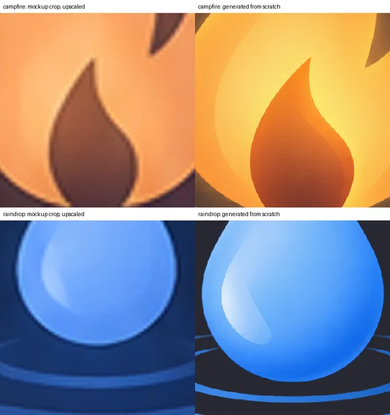</p>

*Left: the element cropped from the mockup and upscaled. Right: the redrawn asset. It's 5–7× the resolution,
40–100× sharper and on a real transparent background.*

## What it does

| Phase | Commands | What you get |
|---|---|---|
| Research | `research`, `blueprint` | In-depth, web-searched, cited market report (competitors, pain points, pricing, gaps) and a feature blueprint (RICE, user stories, screens with mockup briefs, roadmap) using `gpt-6-sol` at high/xhigh reasoning |
| Design | `mockup --platform android\|ios\|web\|macos\|windows\|linux --device phone\|tablet\|foldable\|desktop`, `--set`, `--style-ref`, `critique` | Native-component screens on each device's canvas and chrome, in a clean, decluttered house style; one approved screen carried to every form factor; further screens in the approved design language; automatic design QA with measured contrast and hinge, density and fold checks |
| Inventory | `manifest`, `spec`, `iconspec` | Every asset with bbox, kind and format (native components and system UI excluded); tokens with the native widget per component |
| Raster assets | `forge`, `pick`, `fix` | 1:1 redraws: parallel candidates, perceptual `fid` ranking, Lab colour match, copy/crop rejection |
| Icons | `svg`, `icons`, `vd` | SVG icons scored against the design and retried when weak, on a 24-grid; new icons in the set's style; VectorDrawables validated by render round-trip + aapt2 |
| Vectors | `trace` | Raster art → gradient-aware SVG/VectorDrawable, with a vector-or-raster recommendation |
| App icon | `appicon concepts`, `appicon build` | Android adaptive (foreground, background, themed monochrome), legacy + Play 512, iOS 1024 + dark/tinted, favicons + PWA/maskable |
| Animation | `frames`, `sequence`, `vectorize`, `rig`, `animate` | Procedural motion (no API calls), generated frames with QA, layout-driven sequences (code animates, GPT paints keys, EbSynth carries them to every frame of smoke, drops or spray when the plan says it can, else GPT paints every frame), WebP/APNG/Lottie, Lottie **and** AnimatedVectorDrawable, rigged 1:1 vector animation |
| Hybrid screens | `material`, `state`, `stage` | Screens built in HTML/CSS/JS around GPT-painted materials; state variants pixel-identical outside the change; stills, a frame-exact motion clip and a presentation shot rendered through Chrome |
| Build 1:1 | `fonts`, `redline`, `tokens`, `compare` | Google Fonts matched by rendering; measured radii and gaps; Compose/SwiftUI/CSS/Tailwind theme code; screenshot-vs-design heatmap with ranked fixes |
| Export | `export`, `doctor` | Android densities, iOS imagesets, web 1x/2x; setup check |

**Platform-native design.** The same brief, `--platform android` vs `--platform ios`: M3 top app bar, cards, navigation
bar with the pill indicator and gesture handle vs a large title, inset-grouped list, floating Liquid Glass tab bar and
Dynamic Island.
<p align="center">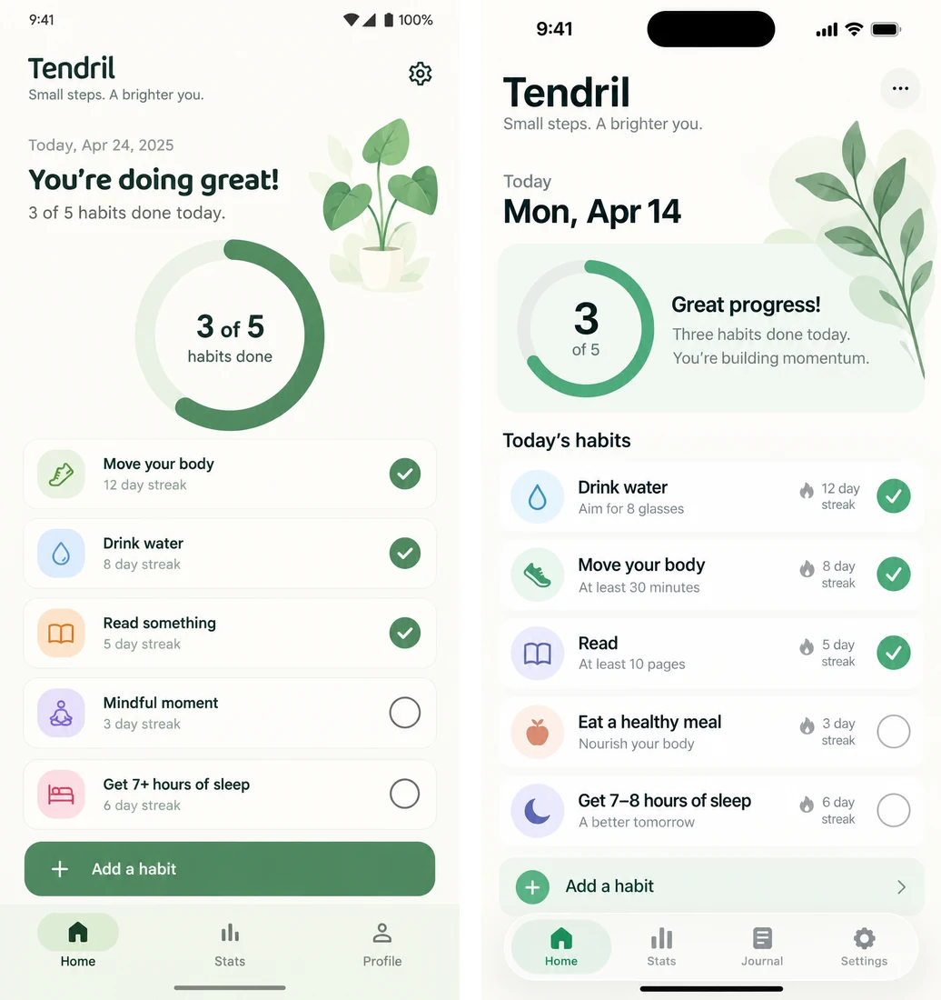</p>

**Every form factor.** `--device tablet` gives list-detail and navigation rails or an iPad sidebar, `--device foldable`
keeps every control off the hinge (and QA measures it), `--device desktop` draws real macOS, Windows or Linux window
chrome at pointer density, and `--platform web --page landing` composes above the fold. `--set tablet,desktop --anchor
<approved phone screen>` recomposes the same app for each form factor instead of stretching it.
<p align="center">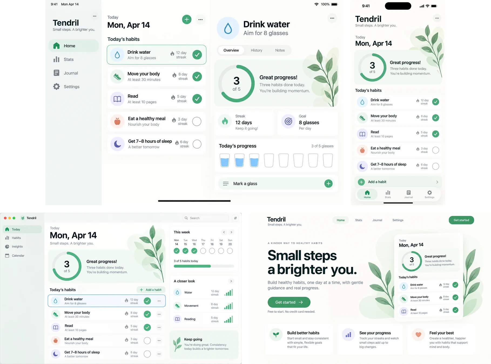</p>

**New screens in the approved design language** (`--style-ref`): same wordmark, tab bar, type and illustration style,
with a new layout.
<p align="center">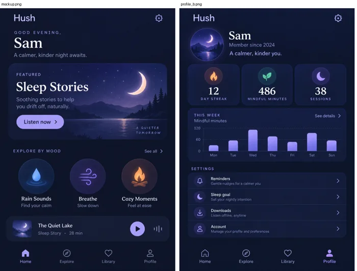</p>

**Forge and icon review sheets.**
<p align="center">
  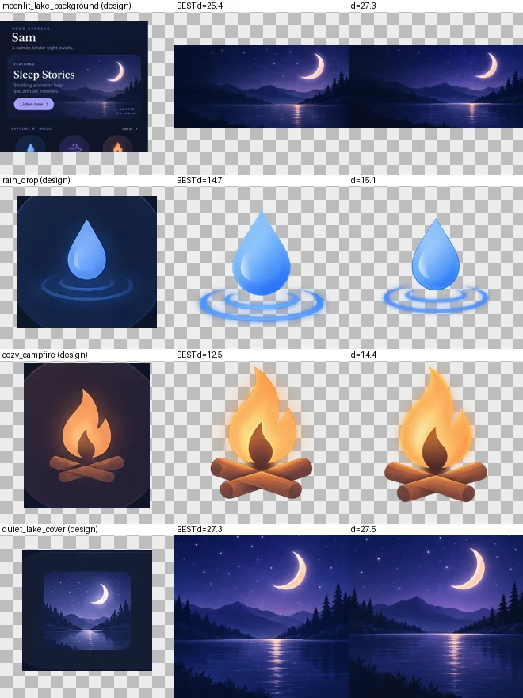
  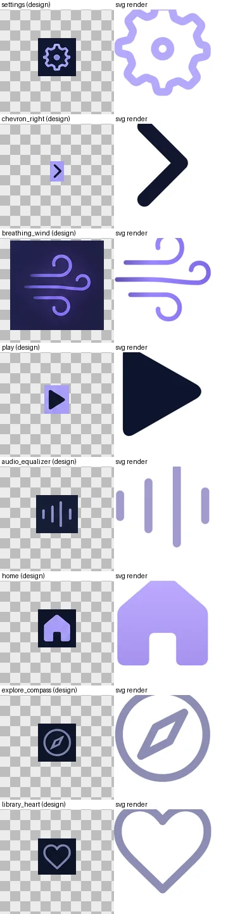
</p>

**App icon.** Adaptive masks, the 66 dp safe zone, the themed glyph, and legacy, iOS dark/tinted, maskable and favicon versions.
<p align="center">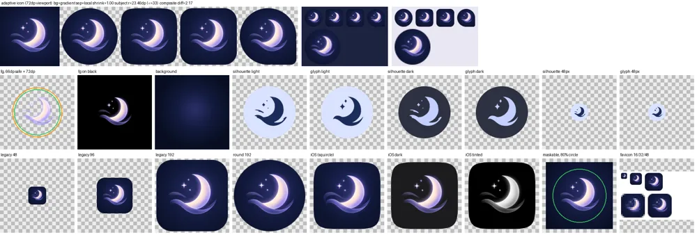</p>

**Tracing.** Gradient-aware vectors: display diff 2.25 vs 5.08 for vtracer.
<p align="center">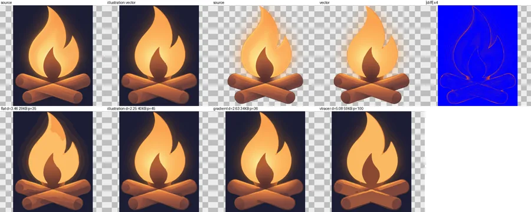</p>

**Animation.** Registered raster frames, and vector motion as both Lottie and AnimatedVectorDrawable (morph, glow, a like-pop).
<p align="center"></p>
<p align="center">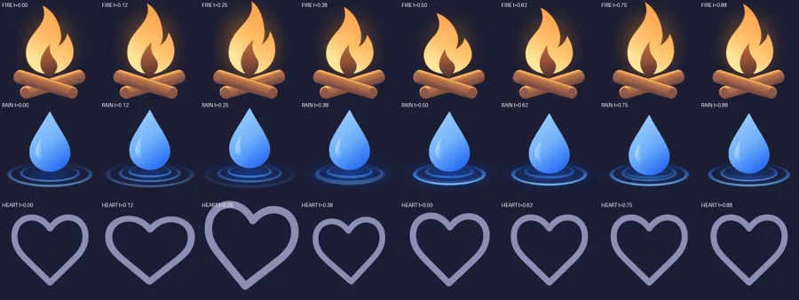</p>

**Compare.** Implementation vs design, with every planted deviation found.
<p align="center">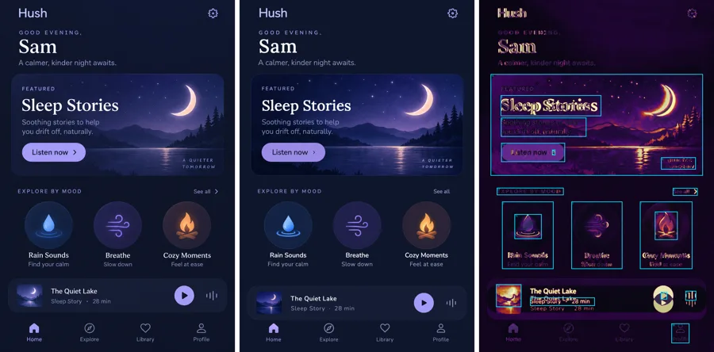</p>

## Install

**As a plugin** (recommended):
```
/plugin marketplace add Shakibuzzaman3104/gpt-ui-assets
/plugin install gpt-ui-assets@gpt-ui-assets
```

**Or as a plain skill**, linked so that `git pull` updates it:
```bash
git clone https://github.com/Shakibuzzaman3104/gpt-ui-assets.git ~/src/gpt-ui-assets
ln -s ~/src/gpt-ui-assets/skills/gpt-ui-assets ~/.claude/skills/gpt-ui-assets
```
A copied folder (`cp -r`) silently stays on the version you copied.

Then install the Python dependencies (Python 3.9+):
```bash
pip install -r ~/.claude/skills/gpt-ui-assets/scripts/requirements.txt   # requests, pillow, numpy
pip install vtracer scipy fonttools playwright                          # optional extras
```
These optional tools are used when present:
- **Headless Chrome/Chromium:** SVG rendering with alpha, lottie-web previews.
- **The Android SDK's `aapt2`:** validates every VectorDrawable, adaptive icon and AVD.
- **`xcrun actool`:** validates the iOS app icon.

## Configure

Pick a backend. The skill asks on first use, or run the setup yourself:
```bash
python3 ~/.claude/skills/gpt-ui-assets/scripts/gptkit.py setup      # shows which backends are ready
```

- **API key** (best for pixel-exact asset work). The OpenAI API or any **OpenAI-compatible** endpoint that exposes
  `/images/generations`, `/images/edits` and `/responses`:
  ```bash
  pbpaste | python3 .../gptkit.py setup --backend api --api-key-stdin   # never echoes or logs the key
  ```
  or write `~/.config/gptkit/env` yourself (`chmod 600`):
  ```ini
  GPTKIT_API_KEY=sk-...
  # optional
  GPTKIT_BASE_URL=https://api.openai.com/v1
  GPTKIT_QUALITY=high          # low | medium | high; low for cheap drafts
  ```
  `OPENAI_API_KEY` and `OPENAI_BASE_URL` are used as fallbacks. Models are routed per task from the endpoint's model
  list; `GPTKIT_IMAGE_MODEL` / `GPTKIT_TEXT_MODEL` pin one.
- **Local Codex CLI** (no key; uses your ChatGPT plan's quota). `npm i -g @openai/codex && codex login`, then
  `gptkit.py setup --backend cli`. Design, critique and research work fully. Its image tool has no size or fidelity
  control, so the kit fits the aspect locally and recommends the API for `forge`, `fix` and `sequence`. Paid commands
  print a `plan:` line in plan quota instead of dollars.

With `GPTKIT_BACKEND=auto` (the default), an API key wins and the Codex CLI is used when there is none. Check
everything with:
```bash
python3 ~/.claude/skills/gpt-ui-assets/scripts/gptkit.py doctor
```

**House style.** Every new design is a clean, decluttered, modern UI with artwork only where it carries meaning, no
ads and an invented product name unless your brief says otherwise. Put your own standing art direction in
`GPTKIT_HOUSE_STYLE` (or `off`); `--no-house-style` skips it once.

**Viewer.** The optional `attachment-preview` mod (in `mods/`) shows every picture the kit prints in a terminal pane:
variant grids, up to four picks side by side, transparent assets on checker, light or dark backdrops, icon contact
sheets, and the aspect and design QA of each picture. Install it with
`/plugin install attachment-preview@gpt-ui-assets`.

## Use

Just talk to Claude:

> Design an Android budgeting app home screen with GPT: this month's balance, spending by category, recent
> transactions and an add-expense button, in warm coral and cream with a friendly piggy-bank mascot.

> The second one. Now the budgets screen in the same style, and the home screen for tablets and the web.

> Go ahead: give me all the assets, the app icon and the fonts, and build it in Compose.

> Make the mascot bounce, and animate the flame as an animated vector.

Claude designs with native components for your platform and device, critiques each variant before showing it, and on "go
ahead" does the rest: inventories and forges the assets, reviews every result, exports to your platform, matches the
fonts, generates theme code, builds the screen and diffs a screenshot of it against the design until it matches. You
can also start from a design made in the ChatGPT app or anywhere else: give Claude the image.

## How it stays 1:1

- **A focused reference beats the full mockup.** The element plus a 60% margin, upscaled, as the single reference
  image. Text-only prompts come out in a generic style.
- **One reference per call.** Multi-image edits were observed to return the mockup itself.
- **Perceptual ranking.** `fid` combines silhouette IoU after alignment, CIELAB distance and a colour-distribution
  distance. It fixed a case where plain pixel diff preferred the wrong candidate.
- **Colour correction.** Redraws drift yellower and more saturated, so a Lab transfer pulls them back to the design.
  It's kept only when the score improves.
- **Automatic rejection.** `COPY`, `OPAQUE`, `BACKDROP` and `CUT-OFF` candidates rank last.
- **Measure, don't guess.** Palette hexes are snapped to pixels (ΔE00 1.35 → 0.36), fonts are matched by rendering,
  radii are measured to within about 1 px, and vision is used for descriptions, never numbers.
- **Animation by layers.** Generate only the moving part, and register everything back to the approved asset.
  Rigged vector parts are completed underneath each other, so motion never tears.

The measurements behind every rule are in [`references/api-findings.md`](skills/gpt-ui-assets/references/api-findings.md).

## Cost and limits

- Each image call takes 35–80 s and is billed at your provider's image pricing. Paid commands print a
  `plan: ~N image calls … ≈ $X` line first; `forge`, `sequence render` and `research` take `--dry-run`, and
  `GPTKIT_BUDGET_USD` stops a command whose estimate is over budget. Every call is logged to
  `~/.cache/gptkit/ledger.jsonl`; `gptkit.py cost --by cmd` sums it at list prices (through a gateway or the
  Codex CLI backend that is plan quota, not money). `forge` with 2–3 candidates makes that
  many calls per raster asset. Icons take one vision call per 6 icons. Procedural animation, tracing, rigging, fonts,
  redline, tokens and compare make no image calls.
- Some backends ignore `quality`, `size` and `n`. The kit measures every render against its canvas, fits it locally
  (empty gaps trimmed or extended, nothing scaled) and runs candidates in parallel.
- Image models don't draw to scale, so sizes are snapped to platform norms and type sizes come from measurement.
- The fidelity thresholds were tuned mainly on dark UI designs. Check the review sheets on very light or busy backgrounds.

## Layout

- `skills/gpt-ui-assets/SKILL.md` is a short router: the rules that hold in every phase and which reference to read.
  Each phase's details are in `skills/gpt-ui-assets/references/`, loaded only when Claude reaches that phase.
- `skills/gpt-ui-assets/scripts/gptkit.py` is the CLI (`python3 gptkit.py <cmd> -h`); the code is the
  `scripts/gptkit/` package, one module per area.
- `mods/attachment-preview/` is the optional viewer mod.
- `python3 gptkit.py status <dir>` shows where a project stands and the next command, with no API calls.
- `CONTRIBUTING.md` has the rules for changing the kit and how to run the tests.

## Changelog

What changed in each release is in [`CHANGELOG.md`](CHANGELOG.md). Security reports: [`SECURITY.md`](SECURITY.md).

## License

[MIT](LICENSE)
